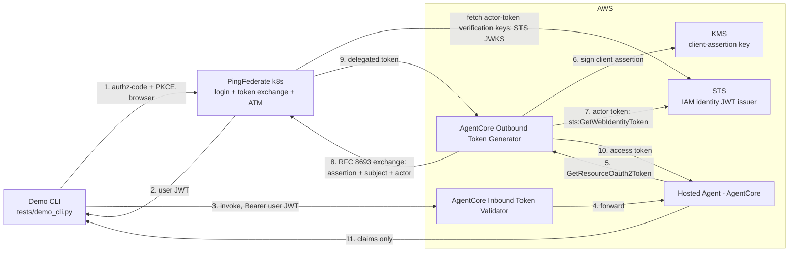

# AgentCore ⇄ PingFederate delegated token exchange

When an AI agent does something for a user, the service on the receiving
end needs to know two things: **which user the work is being done for**,
and **which agent is doing it**. Neither naive option gives both. Handing
the agent the user's own token identifies the user but says nothing about
which agent acted — and the token is as powerful as the user, so anything
the agent does is indistinguishable from the user doing it. Giving the
agent its own service account identifies the agent but erases the user
from the picture. This project demonstrates the OAuth standard built for
exactly this — the **Token Exchange grant (RFC 8693)** — in a fully
secretless setup on AWS Bedrock AgentCore and PingFederate: the agent
presents the user's token as the subject and authenticates itself with
its platform identity (AWS-signed, nothing stored); PingFederate issues
one short-lived token that carries both identities (`sub` = user,
`act.sub` = agent). The user's token is consumed by the exchange — a
resource receives the delegated token, never the user's credential.
AgentCore Identity drives the whole outbound flow, so the agent code
holds no OAuth logic and no credentials.

**What this demo is (and is not).** It covers the identity chain end to
end: PingFederate on Kubernetes (declarative server profile), an agent on
AgentCore Runtime, a demo CLI, and the identity wiring between them (KMS
key, credential provider, IAM grants). Running `tests/demo_cli.py` logs a
user in, invokes the agent, and prints the delegated token's claims. The
agent itself is a **dummy**: it performs no work beyond triggering the
exchange and returning the token's claims to the caller — no LLM, no
downstream calls. There is no resource server in this project; the demo
ends once the claims are on screen.

- Full architecture: **[docs/architecture.md](docs/architecture.md)** —
  flow, components, token shape, and design rationale.

## Logical architecture

The architecture for this POC includes the following components:

- **Demo CLI** — logs the user in with a browser and invokes the agent.
- **AgentCore Inbound Token Validator** — validates the user JWT before
  the invocation reaches the agent.
- **Hosted Agent - AgentCore** — the dummy agent: triggers the exchange,
  returns the claims.
- **AgentCore Outbound Token Generator** — signs the client assertion and
  runs the token exchange on the agent's behalf.
- **KMS** — holds the signing key for the client assertion.
- **STS** — issues the AWS identity JWT used as the actor token.
- **PingFederate** — authenticates the user, validates all three inputs,
  and issues the delegated token.



## The tokens

Four tokens participate in the demo:

**1. User token — issued by PingFederate after the browser login**
(`tests/demo_cli.py`, Authorization Code + PKCE as the confidential client
`agentcore-demo-cli`). This is the exchange's **subject token**; AgentCore
Runtime validates it with its custom JWT authorizer before forwarding it.
In this demo it is a token minted specifically for this agent: its
audience names the agent's invoke endpoint
(`https://agentcore.demo.internal/agents/exchange_agent/invoke`), so it is
only consumable by this agent's runtime authorizer — not by any other
agent or API that trusts the issuer:

```json
{
  "iss": "https://ai-agentcore-token-exchange-pingfederate-engine.ping-devops.com",
  "aud": "https://agentcore.demo.internal/agents/exchange_agent/invoke",
  "sub": "demouser",
  "client_id": "agentcore-demo-cli",
  "scope": "openid demo:read",
  "iat": 1793801505,
  "exp": 1793802405
}
```

**2. Client assertion — signed by AWS KMS, sent as `private_key_jwt` client
authentication** on the exchange request. AgentCore Identity signs it with
the customer-managed KMS key (`kms:Sign`); PingFederate validates it
against the client's inline public-key JWKS. Lifetime is ~90 seconds and it
is minted fresh per exchange:

```json
{
  "iss": "arn:aws:iam::574076504146:role/AgentCore-tokenexchangeag-ApplicationRuntimeExchang-cR6Ap8URe01B",
  "sub": "arn:aws:iam::574076504146:role/AgentCore-tokenexchangeag-ApplicationRuntimeExchang-cR6Ap8URe01B",
  "aud": "https://ai-agentcore-token-exchange-pingfederate-engine.ping-devops.com/as/token.oauth2",
  "jti": "<uuid>",
  "iat": 1793711082,
  "nbf": 1793711082,
  "exp": 1793711172
}
```

**3. Actor token — the AWS IAM identity JWT**, obtained by AgentCore
Identity via `sts:GetWebIdentityToken` (audience = the PingFederate token
endpoint, ≤ 5 minutes). This is the AWS-signed proof of the agent's
workload identity; PingFederate validates it against the account's STS
issuer/JWKS and maps its `sub` into `act.sub`:

```json
{
  "iss": "https://a1d2bfe2-6e32-49b2-ab3c-aefda84f2188.tokens.sts.global.api.aws",
  "aud": "https://ai-agentcore-token-exchange-pingfederate-engine.ping-devops.com/as/token.oauth2",
  "sub": "arn:aws:iam::574076504146:role/AgentCore-tokenexchangeag-ApplicationRuntimeExchang-cR6Ap8URe01B",
  "https://sts.amazonaws.com/": {
    "aws_account": "574076504146",
    "org_id": "o-yodmnogh9l",
    "principal_id": "arn:aws:iam::574076504146:role/AgentCore-tokenexchangeag-ApplicationRuntimeExchang-cR6Ap8URe01B",
    "source_region": "eu-central-1"
  },
  "jti": "<uuid>",
  "iat": 1793713047,
  "nbf": 1793713047,
  "exp": 1793713347
}
```

**4. Delegated token — issued by PingFederate's token-exchange policy**,
combining all three inputs. This is what a downstream resource server would
receive: the user who is being acted for (`sub`), the agent that acts
(`act.sub`, from the AWS JWT), the scope the policy allows, and the
audience (`aud`) — the backend resource the agent declared in the
`resources` parameter of `GetResourceOauth2Token` (here a hypothetical MCP
resource; the delegated ATM selects on this URI):

```json
{
  "iss": "https://ai-agentcore-token-exchange-pingfederate-engine.ping-devops.com",
  "sub": "demouser",
  "act": {
    "sub": "arn:aws:iam::574076504146:role/AgentCore-tokenexchangeag-ApplicationRuntimeExchang-cR6Ap8URe01B"
  },
  "aud": "https://demo.example.internal/resource",
  "client_id": "arn:aws:iam::574076504146:role/AgentCore-tokenexchangeag-ApplicationRuntimeExchang-cR6Ap8URe01B",
  "scope": "demo:read",
  "iat": 1793714119,
  "exp": 1793715019
}
```

The `aud` chain: the **agent** — which knows which backend it needs —
passes the target URI in `GetResourceOauth2Token`'s `resources` parameter;
AgentCore Identity carries it into the token-exchange request (RFC 8707
`resource`); PingFederate's delegated ATM selects on the registered
resource URI and its token mapping stamps the delegated token's `aud` from
it. A `resource` that no ATM claims is rejected with `invalid_target`.

## What the deployed agent actually does

The agent deployed to AgentCore Runtime is a **harness, not a product**: it
does nothing meaningful beyond exercising identity. On each invocation it
(1) takes the workload access token provided by the SDK context, (2) calls
`GetResourceOauth2Token` to trigger the exchange above, (3) decodes the
delegated token and returns its claims to the CLI. No LLM call, no
downstream API. The LLM/tool reference code — showing how the delegated
token would be used in a real agent (a Bedrock turn whose tool calls the
protected resource with the delegated token) — ships **commented out** in
`agent/main.py` with a disclaimer; enabling it is out of scope for this
POC.

## Repository layout

```
docs/architecture.md                  Architecture: flow, components, rationale
docs/agentcore-obo-limitation.md      Why credential-free client auth is impossible
agent/main.py                         The hosted agent (LLM stub disabled)
agentcore/agentcore.json              AgentCore CLI runtime config
agentcore/cdk/                        CDK app: IAM grants (KMS sign, token vault)
tests/demo_cli.py                     The smoke test: login → invoke → claims
tests/pf_common.py                    Shared login helpers (PKCE flow, token cache)
tests/pf_preflight.py                 Read-only PingFederate preflight checks
server-profiles/pingfederate-agentcore/  Declarative PF config (bulk config)
helm/pingfederate/values.yaml         Overrides for Ping's official chart
scripts/                              setup / deploy / verify / validate / uninstall
scripts/teardown-aws.sh               AgentCore stack + provider removal
tests/config.example.env              Smoke-test config template → copy to tests/config.env
.env.example                          Helm deployment template → copy to .env
requirements.txt                      CLI/preflight dependencies (requests, boto3)
```

## Prerequisites

- Kubernetes cluster, `kubectl`, Helm 3; `nginx-public` ingress class
- Ping DevOps user/key for the license (export or `.env`)
- A git repository hosting `server-profiles/pingfederate-agentcore/`
  (`helm/pingfederate/values.yaml` pins it)
- AWS credentials for IAM, KMS, Bedrock AgentCore, ECR (`scripts/setup-aws.sh`
  creates the KMS key and credential provider in Step 1)
- [AgentCore CLI](https://docs.aws.amazon.com/bedrock-agentcore/latest/devguide/agentcore-cli.html)
  (`pip install bedrock-agentcore-starter-toolkit`)
- python3, docker

## Step 1 — AWS identity pieces

One script creates both AWS objects the token exchange needs outside the
repo, and prints every value that must be copied back into it:

```bash
./scripts/setup-aws.sh
```

The script is idempotent — existing objects are detected and reused, never
overwritten — so re-running it is always safe. It creates:

1. **A customer-managed KMS key** (RSA 2048, `SIGN_VERIFY`) with a policy
   letting the `bedrock-agentcore` service sign — AgentCore Identity signs
   the agent's `private_key_jwt` client assertion with it; the private key
   never leaves KMS.
2. **The OAuth2 credential provider** `pingfederate-obo-poc` (CustomOauth2):
   discovery points at this deployment's PingFederate engine, client
   authentication is `PRIVATE_KEY_JWT` bound to the KMS key (assertion
   `kid` = `agentcore-pf-poc-1`), and the on-behalf-of flow is
   `TOKEN_EXCHANGE` with `actorTokenContent = AWS_IAM_ID_TOKEN_JWT` — this
   is what makes AgentCore fetch an AWS identity JWT to act as the
   exchange's actor token. The script also enables STS JWT vending
   (`enable-outbound-web-identity-federation`), which mints that actor
   token, when the account has it disabled.

Then feed the script's output back into the repo — this is why this step
comes first:

- the **KMS key ID** into `agentcore/cdk/lib/cdk-stack.ts` (the
  `KmsSignClientAssertion` grant),
- the **public JWK** into
  `server-profiles/pingfederate-agentcore/instance/bulk-config/data.json.subst`
  (the agent client's inline JWKS — PingFederate holds only this public
  key),
- the **STS issuer + JWKS URL** into `.env`
  (`AWS_STS_ISSUER` / `AWS_STS_JWKS_URL`, consumed by
  `scripts/deploy.sh`) — PingFederate validates actor tokens against that
  JWKS.

The provider's `clientId` is the runtime execution role, which does not
exist until `agentcore deploy` (Step 3) creates it. The script handles
this automatically: the provider starts with a placeholder, and a re-run
of `./scripts/setup-aws.sh` after the agent deploy binds the real role
ARN. One caveat: the local AWS CLI's service model predates the KMS key
binding (`privateKeyJwtConfig`) and cannot manage this provider shape, so
the script drives the provider API through a raw signed request.

## Step 2 — PingFederate on k8s

Three commands deploy a complete authorization server:

```bash
./scripts/validate.sh    # lint: shell, bulk-config JSON, helm render
./scripts/deploy.sh      # helm install of the ping-devops chart: 1 admin + 1 engine
./scripts/verify.sh      # confirm the bulk config imported and the engine is Ready
```

`deploy.sh` pulls the configuration from the GitHub repo pinned in
`helm/pingfederate/values.yaml` (the server profile in this repo — push it
first if you changed it). At startup the admin node imports the profile as
one bulk config, which creates **everything the demo needs**:

- a local demo user you can log in with: **`demouser` / `2FederateM0re`**
  (form login; credentials live in the profile's bulk config),
- the OAuth client the CLI uses: **`agentcore-demo-cli`**, confidential,
  secret `cli-demo-secret`, Authorization Code + PKCE + refresh tokens,
- the OAuth client for the agent: `client_id` = the agent's AWS role ARN,
  authenticated by `private_key_jwt` — PingFederate holds only the KMS
  public key (inline in the profile),
- the token-exchange policy: the user JWT is the subject, the AWS identity
  JWT is the mandatory actor, and the resulting token carries both
  identities plus the audience of the requested resource,
- the token minting rules: RS256 `at+jwt`, 15-minute lifetime, and the
  resource URI the agent may target (`https://demo.example.internal/resource`,
  a stand-in for a real MCP server or API).

PingFederate is then reachable at
`https://<release>-pingfederate-engine.ping-devops.com` (release name =
this folder's name). Object-by-object detail:
[server-profiles/pingfederate-agentcore/README.md](server-profiles/pingfederate-agentcore/README.md).

## Step 3 — Deploy the agent (AgentCore CLI)

Before deploying, `agentcore/agentcore.json` points the pieces at each
other: the **custom JWT authorizer** validates inbound tokens against
PingFederate's OIDC discovery endpoint and accepts only the invoke
audience (`allowedAudience`); the `Authorization` header is allowlisted so
the validated user JWT reaches the agent; and the env vars name the
credential provider (`pingfederate-obo-poc`), the exchange scope
(`demo:read`), and the backend resource the agent requests
(`https://demo.example.internal/resource`). If your PF host differs, edit
`discoveryUrl` and `allowedAudience` there first.

One command deploys the agent container and its IAM role:

```bash
agentcore deploy
agentcore status         # wait for READY; note the runtime ID (…-AbCdEfGhIp)
```

The agentcore CLI also creates the runtime's execution role and its IAM
grants (`kms:Sign`, `sts:GetWebIdentityToken`, token vault), driven by
`agentcore/cdk/lib/cdk-stack.ts`. After this step, re-run
`./scripts/setup-aws.sh` once: it binds the new role ARN into the
credential provider's `clientId` (Step 1 explains why).

## Step 4 — Run the demo

```bash
python3 -m venv .venv && source .venv/bin/activate
pip install -r requirements.txt
cp tests/config.example.env tests/config.env   # set PF_BASE_URL + AGENT_RUNTIME_NAME

python3 tests/pf_preflight.py           # optional: checks PF answers before the flow
python3 tests/demo_cli.py               # login → invoke agent → claims
```

The CLI opens a browser: log in as **`demouser` / `2FederateM0re`**. It
then invokes the agent with the resulting user JWT and prints the
delegated token's claims. Expected output:

```
Authenticating user with PingFederate...
Authentication successful.
Invoking AgentCore agent...
Agent invoked successfully.
AgentCore Identity:
  Outbound token exchange: SUCCESS
  Authentication method:   KMS-signed private_key_jwt (no client secret)
Exchanged PingFederate token claims:
{
  "sub": "demouser",
  "act": { "sub": "arn:aws:iam::<account>:role/AgentCore-tokenexchangeag-..." },
  "aud": "https://demo.example.internal/resource",
  "scope": "demo:read",
  ...
}
RESULT: SUCCESS
```

`sub` proves the user identity, `act.sub` the agent's AWS role, `aud` the
backend the agent requested — the three facts a downstream resource server
would check.

## Teardown

```bash
./scripts/teardown-aws.sh  # AgentCore stack (agentcore CLI) + credential provider
./scripts/uninstall.sh     # PingFederate release
```

The KMS key created in Step 1 is not deleted by teardown (it may hold
other grants); remove it in the console if you no longer need it.

## Security

No client secret is stored for the agent: it authenticates with a KMS-signed
assertion whose private key never leaves AWS KMS, and the PF client holds
only the public key. The CLI is a confidential demo client (secret lives in
the server profile). Tokens are cached locally in `tests/tokens.cache`
(git-ignored); scripts print decoded claims, never raw tokens. `.env` and
`tests/config.env` are git-ignored. The PingFederate Admin API is used read-only
(preflight); configuration flows exclusively from the server profile.
