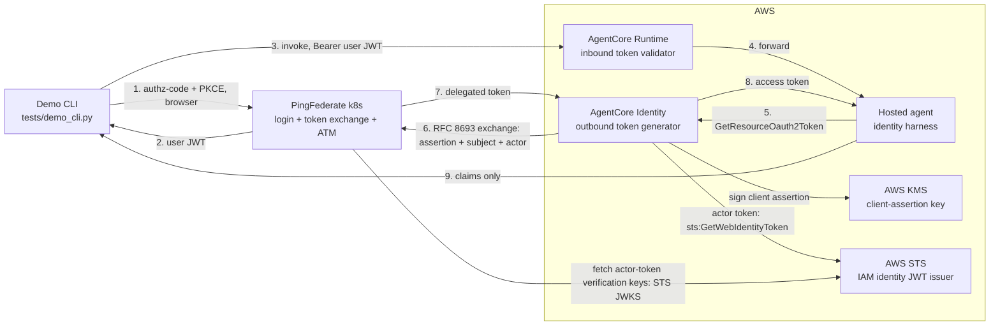

# AgentCore ⇄ PingFederate delegated token exchange

A proof of concept for **delegated, secretless OAuth between an AI agent on
AWS Bedrock AgentCore and APIs protected by PingFederate**.

The problem: an agent acting for a user must call downstream APIs with a
token that proves **both** who the user is and which agent acted for them —
without storing any secret in the agent. The solution: the OAuth 2.0 Token
Exchange grant (RFC 8693). The agent's platform identity (AWS KMS-signed)
authenticates the exchange, the user's token is the subject, and
PingFederate issues one short-lived token carrying both identities
(`sub` = user, `act.sub` = agent). AgentCore Identity drives the whole
outbound flow, so the agent code holds no OAuth logic and no credentials.

- What gets built: PingFederate on k8s (declarative server profile), an
  agent on AgentCore Runtime, a demo CLI — and the identity wiring between
  them (KMS key, credential provider, IAM grants).
- The end state: `tests/demo_cli.py` logs a user in, invokes the agent, and
  prints the delegated token's claims showing user + agent identity.
- Full architecture: **[docs/architecture.md](docs/architecture.md)** —
  flow, components, token shape, and design rationale.

## Logical architecture



## Exchange sequence

```mermaid
sequenceDiagram
    autonumber
    actor U as User
    participant C as CLI
    participant PF as PingFederate
    participant RT as AgentCore Runtime
    participant A as Hosted agent
    participant I as AgentCore Identity
    participant K as AWS KMS
    participant S as AWS STS

    U->>C: start demo
    C->>PF: authorization request, auth-code + PKCE
    PF->>U: login form
    U->>PF: credentials, demouser
    PF-->>C: redirect with code
    C->>PF: token request, code + verifier
    PF-->>C: user JWT, subject token
    C->>RT: invoke, Bearer user JWT
    RT->>RT: custom JWT authorizer validates against PF discovery
    RT->>A: invoke, workload token + user JWT
    A->>I: GetResourceOauth2Token, OBO exchange, scopes, resources
    I->>K: kms:Sign, client assertion, ~90 s
    I->>S: sts:GetWebIdentityToken, aud = PF token endpoint
    S-->>I: AWS IAM identity JWT, actor token
    I->>PF: RFC 8693 exchange, assertion + subject + actor
    PF->>S: fetch JWKS, actor-token verification keys
    PF->>PF: validate assertion, subject, actor; build claims
    PF-->>I: delegated token, sub = user, act.sub = agent role
    I-->>A: access token
    A->>A: decode claims, display only
    A-->>RT: claims
    RT-->>C: claims
    C->>C: print claims
```

## The tokens

Four tokens participate in the demo:

**1. User token — issued by PingFederate after the browser login**
(`tests/demo_cli.py`, Authorization Code + PKCE as the confidential client
`agentcore-demo-cli`). This is the exchange's **subject token**; AgentCore
Runtime validates it with its custom JWT authorizer before forwarding it:

```json
{
  "iss": "https://ai-agentcore-token-exchange-pingfederate-engine.ping-devops.com",
  "aud": "https://agentcore.demo.internal/invoke",
  "sub": "demouser",
  "client_id": "agentcore-demo-cli",
  "scope": "openid demo:read",
  "iat": 1793712826,
  "exp": 1793713726
}
```

**2. Client assertion — signed by AWS KMS, sent as `private_key_jwt` client
authentication** on the exchange request. AgentCore Identity signs it with
the customer-managed KMS key (`kms:Sign`); PingFederate validates it
against the client's inline public-key JWKS. Lifetime is ~90 seconds and it
is minted fresh per exchange:

```json
{
  "iss": "arn:aws:iam::574076504146:role/AgentCore-tokenexchangeag-ApplicationRuntimeExchang-cR6Ap8URe01B",
  "sub": "arn:aws:iam::574076504146:role/AgentCore-tokenexchangeag-ApplicationRuntimeExchang-cR6Ap8URe01B",
  "aud": "https://ai-agentcore-token-exchange-pingfederate-engine.ping-devops.com/as/token.oauth2",
  "jti": "<uuid>",
  "iat": 1793711082,
  "nbf": 1793711082,
  "exp": 1793711172
}
```

**3. Actor token — the AWS IAM identity JWT**, obtained by AgentCore
Identity via `sts:GetWebIdentityToken` (audience = the PingFederate token
endpoint, ≤ 5 minutes). This is the AWS-signed proof of the agent's
workload identity; PingFederate validates it against the account's STS
issuer/JWKS and maps its `sub` into `act.sub`:

```json
{
  "iss": "https://a1d2bfe2-6e32-49b2-ab3c-aefda84f2188.tokens.sts.global.api.aws",
  "aud": "https://ai-agentcore-token-exchange-pingfederate-engine.ping-devops.com/as/token.oauth2",
  "sub": "arn:aws:iam::574076504146:role/AgentCore-tokenexchangeag-ApplicationRuntimeExchang-cR6Ap8URe01B",
  "https://sts.amazonaws.com/": {
    "aws_account": "574076504146",
    "org_id": "o-yodmnogh9l",
    "principal_id": "arn:aws:iam::574076504146:role/AgentCore-tokenexchangeag-ApplicationRuntimeExchang-cR6Ap8URe01B",
    "source_region": "eu-central-1"
  },
  "jti": "<uuid>",
  "iat": 1793713047,
  "nbf": 1793713047,
  "exp": 1793713347
}
```

**4. Delegated token — issued by PingFederate's token-exchange policy**,
combining all three inputs. This is what a downstream resource server would
receive: the user who is being acted for (`sub`), the agent that acts
(`act.sub`, from the AWS JWT), the scope the policy allows, and the
audience (`aud`) — the backend resource the agent declared in the
`resources` parameter of `GetResourceOauth2Token` (here a hypothetical MCP
resource; the delegated ATM selects on this URI):

```json
{
  "iss": "https://ai-agentcore-token-exchange-pingfederate-engine.ping-devops.com",
  "sub": "demouser",
  "act": {
    "sub": "arn:aws:iam::574076504146:role/AgentCore-tokenexchangeag-ApplicationRuntimeExchang-cR6Ap8URe01B"
  },
  "aud": "https://demo.example.internal/resource",
  "client_id": "arn:aws:iam::574076504146:role/AgentCore-tokenexchangeag-ApplicationRuntimeExchang-cR6Ap8URe01B",
  "scope": "demo:read",
  "iat": 1793714119,
  "exp": 1793715019
}
```

The `aud` chain: the **agent** — which knows which backend it needs —
passes the target URI in `GetResourceOauth2Token`'s `resources` parameter;
AgentCore Identity carries it into the token-exchange request (RFC 8707
`resource`); PingFederate's delegated ATM selects on the registered
resource URI and its token mapping stamps the delegated token's `aud` from
it. A `resource` that no ATM claims is rejected with `invalid_target`.

## What the deployed agent actually does

The agent deployed to AgentCore Runtime is a **harness, not a product**: it
does nothing meaningful beyond exercising identity. On each invocation it
(1) takes the workload access token provided by the SDK context, (2) calls
`GetResourceOauth2Token` to trigger the exchange above, (3) decodes the
delegated token and returns its claims to the CLI. No LLM call, no
downstream API. The LLM/tool reference code — showing how the delegated
token would be used in a real agent (a Bedrock turn whose tool calls the
protected resource with the delegated token) — ships **commented out** in
`agent/main.py` with a disclaimer; enabling it is out of scope for this
POC.

## Repository layout

```
docs/architecture.md                  Architecture: flow, components, rationale
docs/agentcore-obo-limitation.md      Why credential-free client auth is impossible
agent/main.py                         The hosted agent (LLM stub disabled)
agentcore/agentcore.json              AgentCore CLI runtime config
agentcore/cdk/                        CDK app: IAM grants (KMS sign, token vault)
tests/demo_cli.py                     The smoke test: login → invoke → claims
tests/pf_common.py                    Shared login helpers (PKCE flow, token cache)
tests/pf_preflight.py                 Read-only PingFederate preflight checks
server-profiles/pingfederate-agentcore/  Declarative PF config (bulk config)
helm/pingfederate/values.yaml         Overrides for Ping's official chart
scripts/                              deploy / verify / validate / uninstall
scripts/teardown-aws.sh               AgentCore stack + provider removal
tests/config.example.env              Smoke-test config template → copy to tests/config.env
.env.example                          Helm deployment template → copy to .env
requirements.txt                      CLI/preflight dependencies (requests, boto3)
```

## Prerequisites

- Kubernetes cluster, `kubectl`, Helm 3; `nginx-public` ingress class
- Ping DevOps user/key for the license (export or `.env`)
- A git repository hosting `server-profiles/pingfederate-agentcore/`
  (`helm/pingfederate/values.yaml` pins it)
- AWS credentials for IAM, Bedrock AgentCore, ECR; a customer-managed KMS
  key (RS256) — the key ID is pinned in `agentcore/cdk/lib/cdk-stack.ts`
- [AgentCore CLI](https://docs.aws.amazon.com/bedrock-agentcore/latest/devguide/agentcore-cli.html)
  (`pip install bedrock-agentcore-starter-toolkit`)
- python3, docker

## Step 1 — PingFederate on k8s

```bash
./scripts/validate.sh
./scripts/deploy.sh                     # 1 admin + 1 engine, bulk config at startup
./scripts/verify.sh                     # confirm import + engine Ready
```

The profile is self-contained: hostname variables are image-provided and
the KMS client material is inline. It provisions the demo form login, the
token processors, the token-exchange policy (actor token mandatory), the
confidential CLI client, and the agent client (KMS public key,
`private_key_jwt`). See
[server-profiles/pingfederate-agentcore/README.md](server-profiles/pingfederate-agentcore/README.md).

## Step 2 — AWS identity setup (out-of-band)

The KMS key and the `pingfederate-obo-poc` credential provider
(CustomOauth2, `private_key_jwt` client auth, `AWS_IAM_ID_TOKEN_JWT` actor
  token) are created out-of-band;
`agentcore/cdk/lib/cdk-stack.ts` documents the IAM shape.

## Step 3 — Deploy the agent (AgentCore CLI)

```bash
# edit agentcore/agentcore.json: discoveryUrl → your PF host,
#   allowedAudience → the AgentCore invoke audience
agentcore deploy
agentcore status         # wait for READY; note the runtime ID for the CLI
```

The runtime is declared with `requestHeaderAllowlist: ["Authorization"]`
(forwards the validated user JWT), `protocol: HTTP`, and the custom JWT
authorizer against PingFederate's OIDC discovery endpoint.

## Step 4 — Run the demo

```bash
python3 -m venv .venv && source .venv/bin/activate
pip install -r requirements.txt
cp tests/config.example.env tests/config.env   # PF_BASE_URL, AGENT_RUNTIME_NAME, etc.

python3 tests/pf_preflight.py           # optional: endpoints + PF config checks
python3 tests/demo_cli.py               # login → invoke agent → claims
```

Expected CLI output:

```
Authenticating user with PingFederate...
Authentication successful.
Invoking AgentCore agent...
Agent invoked successfully.
AgentCore Identity:
  Outbound token exchange: SUCCESS
  Authentication method:   KMS-signed private_key_jwt (no client secret)
Exchanged PingFederate token claims:
{
  "act": { "sub": "arn:aws:iam::<account>:role/AgentCore-tokenexchangeag-..." },
  "aud": "<DEMO_RESOURCE_URI>",
  "scope": "demo:read",
  "sub": "demouser"
}
RESULT: SUCCESS
```

The agent source also contains the LLM/tool reference code, **commented
out** with a disclaimer: the demo's goal is the delegated exchange; that
code shows how the exchanged token would be used downstream by a real agent.

## Teardown

```bash
./scripts/teardown-aws.sh  # runtime (agentcore CLI) + credential provider;
                         # the KMS key is out-of-band and not removed
./scripts/uninstall.sh   # PingFederate release
```

## Security

No client secret is stored for the agent: it authenticates with a KMS-signed
assertion whose private key never leaves AWS KMS, and the PF client holds
only the public key. The CLI is a confidential demo client (secret lives in
the server profile). Tokens are cached locally in `tests/tokens.cache`
(git-ignored); scripts print decoded claims, never raw tokens. `.env` and
`tests/config.env` are git-ignored. The PingFederate Admin API is used read-only
(preflight); configuration flows exclusively from the server profile.
